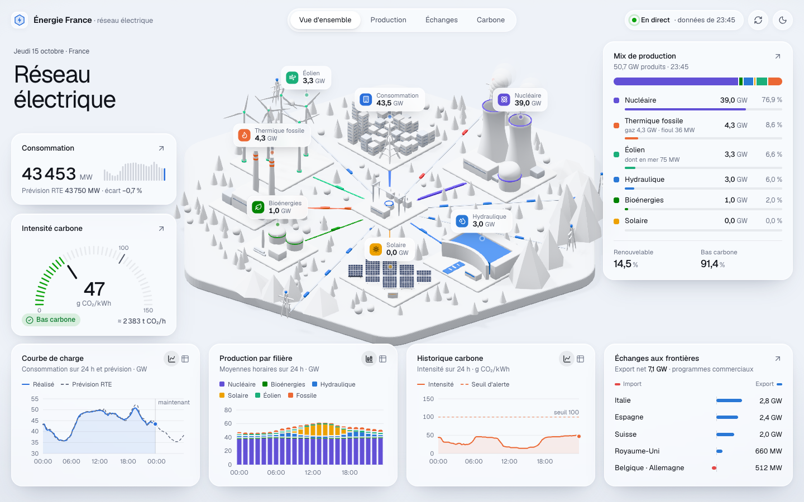
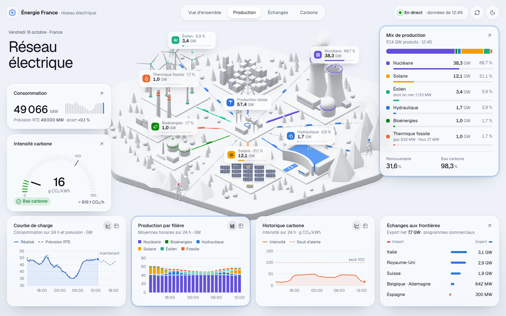
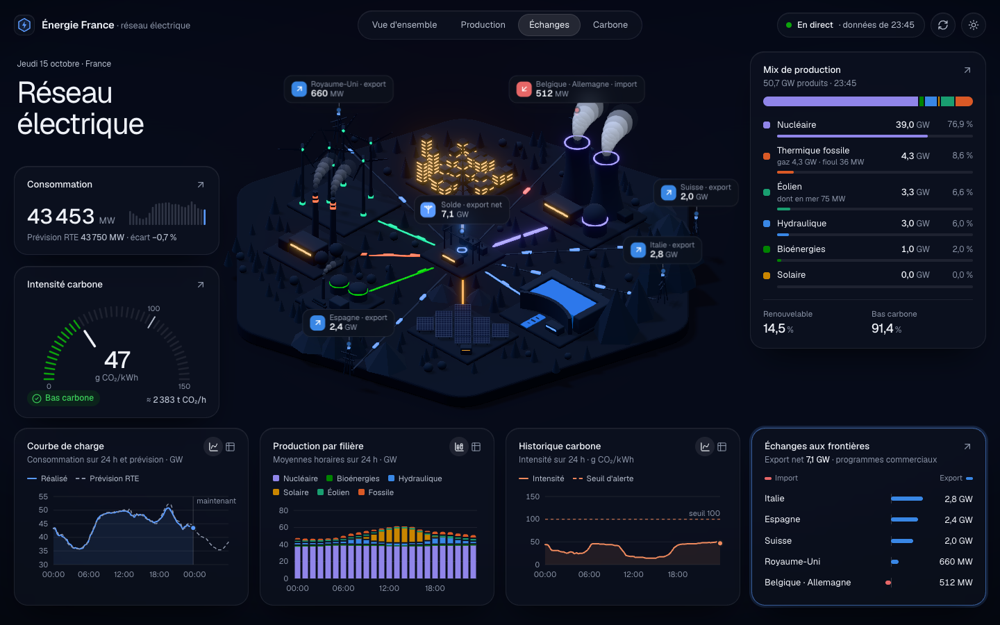

# ⚡ Énergie France

**Le réseau électrique français, en direct.**

▶ **[energy-dashboard-red.vercel.app](https://energy-dashboard-red.vercel.app)**

<p align="center">
  
</p>

<table>
  <tr>
    <td width="50%"></td>
    <td width="50%"></td>
  </tr>
  <tr>
    <td align="center"><sub>Production par filière</sub></td>
    <td align="center"><sub>Échanges avec les voisins · thème nuit</sub></td>
  </tr>
</table>

## 🔄 Mis à jour toutes les 5 minutes

Données RTE éCO2mix · pas de 15 minutes · mode démo si la source est indisponible

## 🧪 Lancer en local

```bash
npm install
npm run dev
```

Puis ouvrir [localhost:3000](http://localhost:3000). Ou avec Docker : `docker compose up --build`.

<sub>Source : [ODRE](https://odre.opendatasoft.com), dataset `eco2mix-national-tr` · Seuil CO₂ et fréquence réglables via `CO2_THRESHOLD` et `REFRESH_INTERVAL_SECONDS`.</sub>
